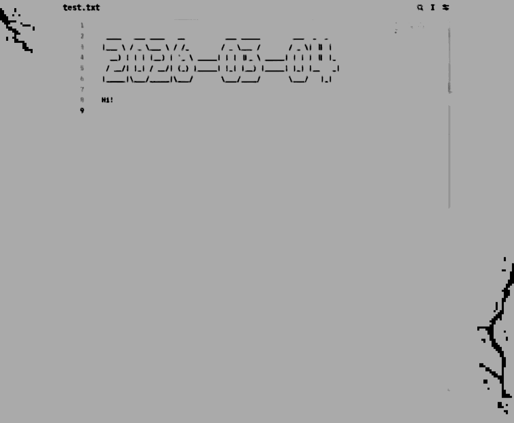
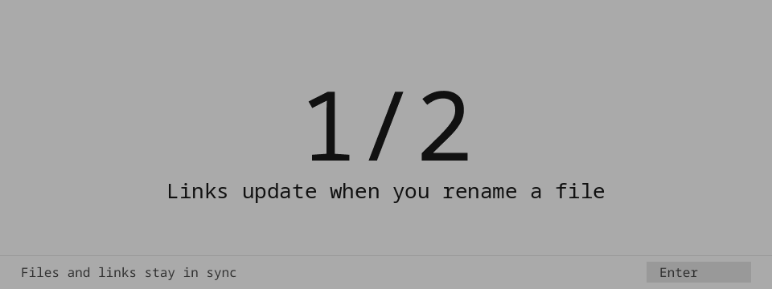
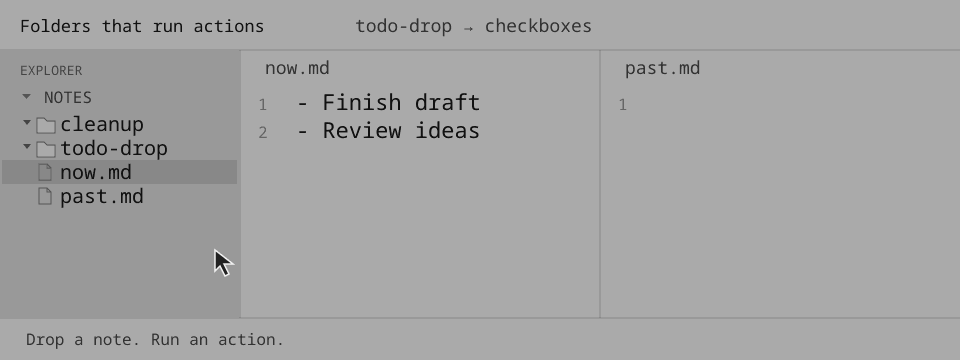
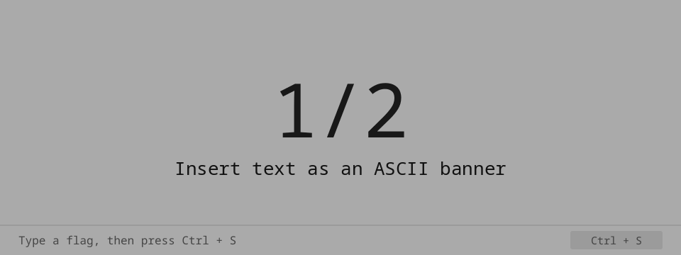
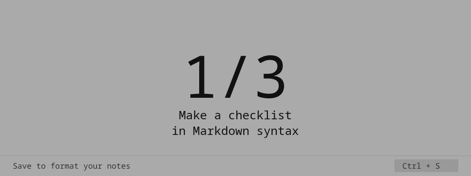
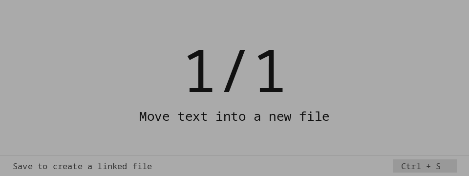
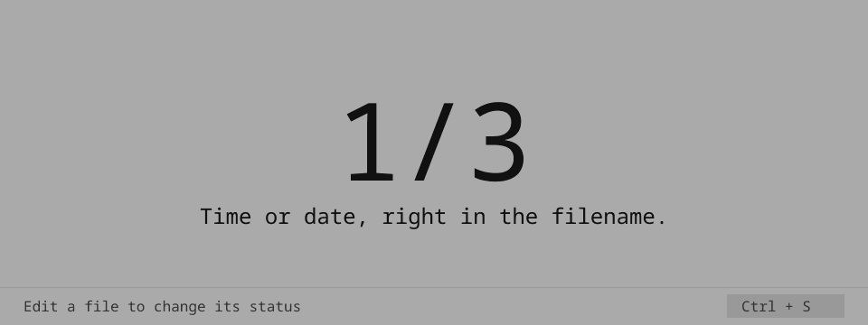
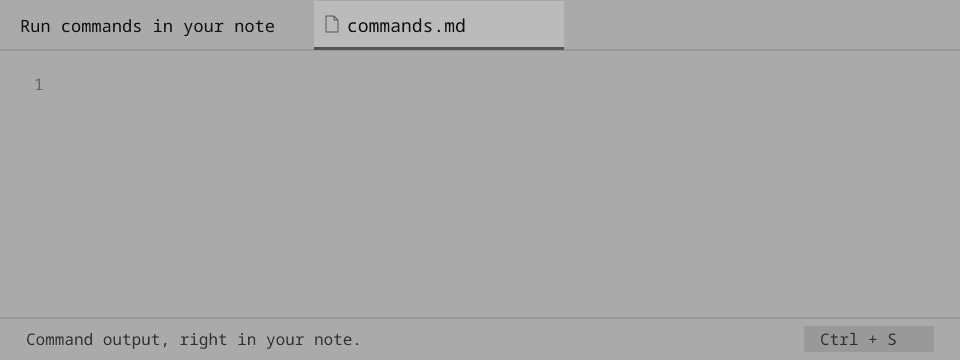

# Lucy — turn plain text into actions

The daemon monitors your directory using `inotify` and reacts to file events.

You can give Lucy commands directly inside a file and get the output right there.

For example, to run a shell command:

`--cmd neofetch`

Press `CTRL+S` — the command output appears on the next line.

Lucy works at the filesystem level. Use any editor you like. You don't need any plugins.




## Theory

### Argument system

All command arguments (`--args`) use Unix-style syntax. You can provide them in three places:

1. Inside a note file (local, for per-note behavior)
2. In `config.txt` (global)
3. At startup: `python3 main_daemon.py --arg` (global)

See [CHEATSHEET.md](CHEATSHEET.md) for all `--args`.

### Use `--help`

```text
* `--mods`: list loaded modules and their priorities.
* `--ping`: send a notification and replace the command line with `++pong!`.
* `--config`: show config values that differ from the defaults.
* `--man <name>`: show an argument and its description (for example, `--man mods` or `--man --mods`).
```

### `--mods` to see loaded modules and their priorities

```text
* sys (2)
* banner (10)
* renamer (20)
* status (21)
* linker (22)
```

### `--man <name/module>` to read the manual


## Modules

**Basic modules (loaded by default):**

- `sys`: shows runtime information and command help.<br>
  
- `linker`: keeps Markdown links and symlinks in sync and pins active notes.<br>
  
- `archive`: moves idle text to an archive note, keeping the working note clear.<br>
  
- `dropdir`: runs actions when you drop notes into configured folders.<br>
  
- `renamer`: renames notes and automatically names scratch files by date.<br>
  
- `banner`: inserts ASCII banners with text or dates.<br>
  
- `formatter`: formats notes, converts bullet lists into checklists, and autocompletes Lucy arguments.<br>
  
- `graph`: creates graph blocks showing word frequencies.<br>
  
- `include`: inserts complete files or matching paragraphs into notes.<br>
  
- `new`: moves text into a new file and leaves a Markdown link in its place.<br>
  
- `status`: updates filenames with dynamic tokens (time, date, Git status, animations).<br>
  
- `alias`: expands command shortcuts and text snippets.<br>
  
- `workspace`: initializes a default notes workspace with Git and systemd files.

**Integration modules:**

- `git`: syncs notes with a remote Git repository.
- `plasma_widget`: syncs Markdown notes with KDE Plasma note widgets ([see video](media/plasma_widget.mp4)).

**WIP modules:**

- `cmd`: runs commands. Not loaded by default for security reasons.<br>
  
- `kdeconnect_sync`: sends note changes to your phone via KDE Connect.
- `voice`: transcribes speech into notes using offline Vosk or online speech providers.
- `ai`: uses a local agent to edit the current note based on an inline prompt.
- `email`: reads email as notes, sends drafts, and manages messages by moving files.

See [CHEATSHEET.md](CHEATSHEET.md) for all arguments.


## Installation

Warnings:

- **Turn on automatic file reloading in your text editor!**
- The project has only been tested on GNU/Linux distributions. Sorry :<
- The daemon does not support `opened` events on macOS or Windows (for example, the Git module uses these events to sync your repository).

1. Clone the repository:

```sh
git clone --depth 1 https://codeberg.org/vvindetta/demon_lucy && cd demon_lucy
```

2. Install Python dependencies:

```
python3 -m pip install -r requirements.txt
```

3. Edit the config file, using `config.txt` as a template.
Uncomment and edit the lines you need.

### Running manually

Run Lucy in daemon mode:

```text
python3 main_daemon.py --sys-config-path "/home/user/Notes/.lucy/config.txt"
```

Run Lucy in oneshot mode (useful for scripts and scheduled runs):

```text
python3 main_oneshot.py \
  --oneshot-event opened \
  --oneshot-paths "/home/user/Notes/file.md" \
  --sys-modules git
```

### Systemd setup

The repository includes four systemd unit files in `setup-systemd/`:

- [lucy-daemon.service](setup-systemd/lucy-daemon.service): watches for note events in real time.
- [lucy-daemon.timer](setup-systemd/lucy-daemon.timer): starts the daemon 30 seconds after the user service manager starts.
- [lucy-oneshot.service](setup-systemd/lucy-oneshot.service): runs once and exits; suitable for scheduled or manual tasks.
- [lucy-oneshot.timer](setup-systemd/lucy-oneshot.timer): starts `lucy-oneshot.service` on a schedule.

Edit the service files and set the paths to your repository, notes, and config.
Alternatively, use the files generated by the `workspace` module, but verify
all paths before enabling the services.

Default service paths:

- repo: `$HOME/demon_lucy`
- notes: `$HOME/Notes`
- config: `$HOME/Notes/.lucy/config.txt`

Move the unit files:

```bash
mkdir -p ~/.config/systemd/user; \
mv setup-systemd/lucy-daemon.service ~/.config/systemd/user/; \
mv setup-systemd/lucy-daemon.timer ~/.config/systemd/user/; \
mv setup-systemd/lucy-oneshot.service ~/.config/systemd/user/; \
mv setup-systemd/lucy-oneshot.timer ~/.config/systemd/user/
```

Reload systemd and enable the timers:

```bash
systemctl --user daemon-reload; \
systemctl --user enable --now lucy-daemon.timer; \
systemctl --user enable --now lucy-oneshot.timer
```

Useful checks:

```text
systemctl --user status lucy-daemon.service
systemctl --user status lucy-daemon.timer
systemctl --user status lucy-oneshot.timer
systemctl --user start lucy-oneshot.service
journalctl --user -u lucy-daemon.service -f
```

## Android setup

You can run Lucy in [Termux](https://f-droid.org/packages/com.termux/).

Install these apps from F-Droid:

- [Termux](https://f-droid.org/packages/com.termux/): terminal and shell environment.

Optional add-ons:

- [Termux:Boot](https://f-droid.org/packages/com.termux.boot/): place a startup script in `~/.termux/boot/` to run it automatically after boot.
- [Termux:Widget](https://f-droid.org/packages/com.termux.widget/): place a script in `~/.shortcuts/` to run it from the widget.
- [Termux:Tasker](https://f-droid.org/packages/com.termux.tasker/): place a script in `~/.termux/tasker/` to run it from Tasker automations.
- [Termux:API](https://f-droid.org/packages/com.termux.api/): enables `termux-job-scheduler`, `termux-wake-lock` and notifications.

I recommend [Markor](https://github.com/gsantner/markor) as a text editor.

Ready-to-use Termux scripts are in `setup-termux/`:

- `lucy-daemon.sh`
- `lucy-oneshot.sh`
- `lucy-job-scheduler.sh`

Default script paths:

- repo: `$HOME/demon_lucy`
- notes: `$HOME/storage/shared/Notes`
- config: `$HOME/storage/shared/Notes/.lucy/config.txt`
- state/logs: `$HOME/.lucy`

You can also schedule periodic mobile sync through Android JobScheduler using [lucy-job-scheduler.sh](setup-termux/lucy-job-scheduler.sh). In this mode, use Termux:Boot only to register the persistent job after reboot.
